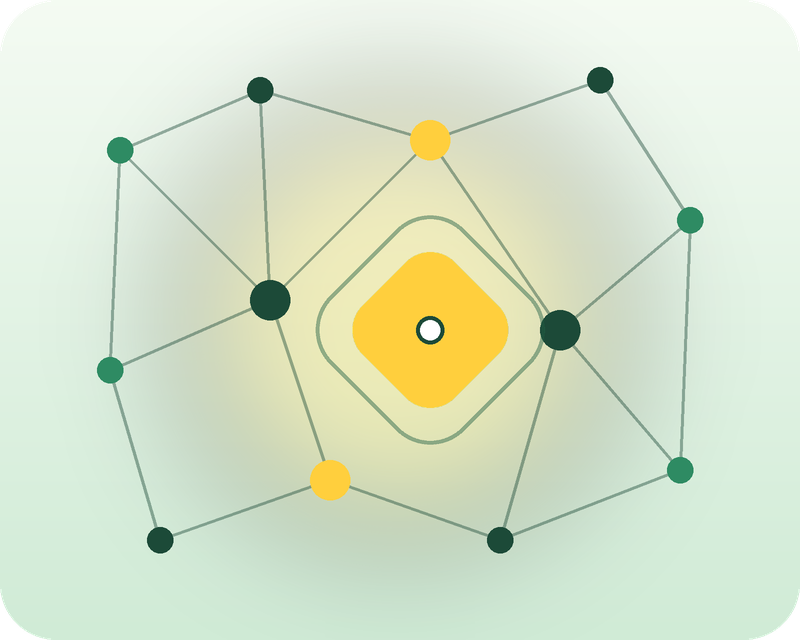

```{=html}
<style>
.story-row {
  display: flex;
  align-items: center;
  gap: 2rem;
  margin: 2.5rem 0;
}
.story-row.reverse {
  flex-direction: row-reverse;
}
.story-row > :first-child {
  flex: 0 0 280px;
  margin: 0;
}
.story-row .story-img {
  width: 100%;
  border-radius: 24px;
  box-shadow: 0 6px 18px rgba(28, 74, 56, 0.15);
}
.story-row > :last-child {
  margin: 0;
}
@media (max-width: 700px) {
  .story-row, .story-row.reverse {
    flex-direction: column;
  }
  .story-row > :first-child {
    flex: none;
    width: 100%;
  }
}
</style>
```

**Hi, I'm Gyna.**

::: {.story-row}
{.story-img}

Change is inevitable. As the world is changing to include AI - well, in this case it is already incorporated into our day-to-day lives and our work environments. And honestly, I'm here for it. I welcome the positive benefits that artificial intelligence contributes to the betterment of society and the human condition. Thus, after careful introspection of the best ways to use my knowledge and talent of human capital, business acumen, and pattern recognition; I pledge to collect and interpret data in a socially responsible way.
:::

::: {.story-row .reverse}
{.story-img}

Research is not necessarily new to me but I took for granted the impact data collection has on decision making at both the micro and macro levels. Understanding that data collection - rather the interpretation of collected data is the catalyst that shapes commerce, marketing, and social policy; it's the driving force of how goods and services are now being rendered to the everyday person.
:::

::: {.story-row}
{.story-img}

This website is a reintroduction of research and data analysis but also a real time pivot in my career from direct implementation of services to provide direction for staff, identify gaps in training, and deliver service based outcomes, using tools such as R, SQL and Quarto. Learning data analysis using synthetic databases allows me to showcase the reasoning behind each decision, documented as I rebuild the skill from the ground up.
:::

My background is in sociology and HR-adjacent work. You can read more about that path on the [My Journey](about.qmd) page. This site itself is focused on the work: browse [Learning Progress](learning.qmd) to see what I've built so far and visit the Blog for my thoughts on real-world topics and my response to current events.