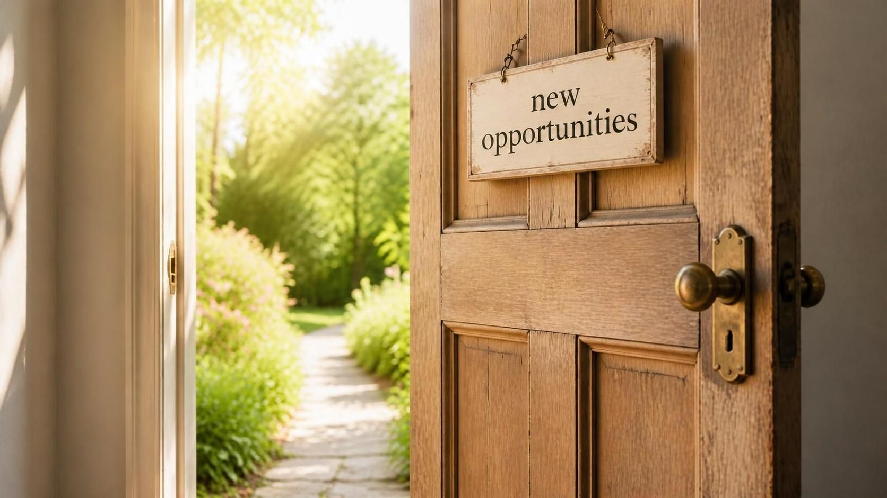

```{=html}
<link href="https://fonts.googleapis.com/css2?family=Playfair+Display:ital,wght@0,600;0,700;1,400&display=swap" rel="stylesheet">
<style>
body {
  background-color: #eaf5ea;
}
.quarto-title-banner {
  aspect-ratio: 1920 / 330 !important;
  min-height: 240px;
  padding: 0 0 0 8% !important;
  margin-bottom: 0 !important;
  background-size: cover !important;
  background-position: center !important;
  box-shadow: inset 0 0 0 2000px rgba(16, 56, 42, 0.35);
  display: flex !important;
  align-items: center !important;
  justify-content: flex-start !important;
  text-align: left !important;
}
.quarto-title-banner * {
  color: white !important;
  text-align: left !important;
}
.quarto-title-banner h1.title {
  display: none !important;
}
.quarto-title-banner .subtitle {
  font-family: 'Playfair Display', serif !important;
  font-weight: 600 !important;
  text-transform: uppercase !important;
  letter-spacing: 0.1em !important;
  line-height: 1.25 !important;
  font-size: clamp(1.6rem, 4.5vw, 3.4rem) !important;
  text-shadow: 0 3px 12px rgba(0, 0, 0, 0.25);
  margin: 0 !important;
}

.hero {
  display: flex;
  flex-wrap: wrap;
  align-items: center;
  justify-content: center;
  gap: 3rem;
  margin: 3rem 0;
}
.hero-photo img {
  width: 230px;
  height: 230px;
  max-width: 230px;
  object-fit: cover;
  border-radius: 50%;
  box-shadow: 0 0 0 8px rgba(46, 139, 99, 0.15), 0 0 40px 10px rgba(46, 139, 99, 0.45);
}
.hero-text {
  max-width: 480px;
}
.hello {
  font-size: 1.3rem;
  font-weight: 600;
  margin: 0;
}
.hero-name {
  font-family: 'Playfair Display', serif;
  font-size: 2.8rem;
  font-weight: 700;
  line-height: 1.1;
  margin: 0.2rem 0;
}
.hero-role {
  font-size: 1.5rem;
  font-weight: 600;
  margin: 0 0 1rem;
}
.hero-role span {
  color: #2e8b63;
}
.hero-blurb {
  font-size: 1rem;
  margin-bottom: 1.5rem;
}
.btn-main, .btn-alt {
  display: inline-block;
  padding: 0.65rem 1.4rem;
  margin: 0.25rem 0.4rem 0.25rem 0;
  border-radius: 999px;
  font-weight: 600;
  text-decoration: none !important;
}
.btn-main {
  background: #1c4a38;
  color: white !important;
}
.btn-alt {
  border: 2px solid #1c4a38;
  color: #1c4a38 !important;
}
</style>

<div class="hero">
  <div class="hero-photo">
    
  </div>
  <div class="hero-text">
    <p class="hello">Hello, I'm</p>
    <div class="hero-name">Gyna Jones</div>
    <p class="hero-role">And I'm a <span>Data Analyst</span></p>
    <p class="hero-blurb">Welcome to my data analytics portfolio. I'm building my skills in R, SQL, and Quarto with real exercises, real code, and the reasoning behind every decision, with the goal of collecting and interpreting data in a socially responsible way.</p>
    <a class="btn-main" href="learning.html">View My Work</a>
    <a class="btn-alt" href="about.html">My Journey</a>
  </div>
</div>
```
